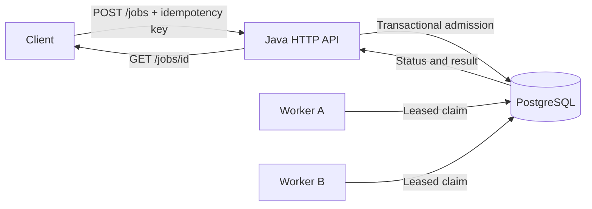

# Job Intake Service

**Durable job acceptance, safe retries, and crash-recoverable workers — built with Java 21 and PostgreSQL.**

A focused backend engineering reference that explores what happens when clients retry after ambiguous commits, concurrent API instances accept the same work, workers crash, and PostgreSQL becomes unavailable. Instead of hiding these cases behind a framework, the project makes its transaction boundaries and operational limits explicit.

> **Scope:** A runnable, local reference implementation and a reproducible reliability laboratory — **not** a deployed multi-tenant production queue. Jobs run a deterministic SHA-256 calculation, not arbitrary user instructions or external effects.

## At a glance

| Concern | Implementation |
| --- | --- |
| **Durable acceptance** | PostgreSQL transactions; acknowledge a new job only after commit |
| **Idempotent HTTP** | Same key + same payload → original job ID (200); conflicting payload → 409 |
| **Concurrent API instances** | Shared row lock, unique key constraint and global capacity enforcement |
| **Execution recovery** | Background workers, leased claims, ownership tokens, stale-worker fencing and bounded retries |
| **Operational limits** | Loopback HTTP, bounded handler threads/queue, readiness/liveness separation, metrics and graceful shutdown |
| **Database lifecycle** | Explicit checksum-verified migrations; preserved state across Java restarts |
| **Optional JDBC pooling** | Explicitly enabled HikariCP pool, 1–8 connections per API process; fresh JDBC stays the default |
| **Evidence** | Real PostgreSQL integration checks, independent-JVM races, fault-focused pool tests and CI benchmark reports |

## Architecture



The API and workers share PostgreSQL as the durable source of truth. Admission serializes on a configuration row to preserve a global job-capacity bound. Workers use database-backed claims and ownership fencing; expired work can be retried, so execution is **at least once**, not exactly once. See the [architecture and trade-offs](docs/design.md) and [worker lifecycle](docs/worker-walkthrough.md).

## Run locally

Requires **JDK 21+**, PostgreSQL 17+ (or Docker Compose), `curl` and `shasum`. Build scripts retrieve checksum-pinned pgJDBC, HikariCP and SLF4J API jars from Maven Central; no Maven/Gradle installation is needed.

```sh
export DATABASE_URL='jdbc:postgresql://127.0.0.1:5432/jobs'
export DATABASE_USER=jobs
read -r -s -p 'Local database password: ' DATABASE_PASSWORD; echo
export DATABASE_PASSWORD

docker compose up -d --wait
./migrate.sh
./run.sh 8080
```

The password command above uses Bash. Environment variables are not loaded automatically from `.env`. Existing PostgreSQL installations should use a UTF-8 database; custom schemas must already exist. Migrations are explicit and checksum-verified, preserving existing jobs.

In another terminal:

```sh
curl -i -X POST http://127.0.0.1:8080/jobs \
  -H 'Content-Type: text/plain' \
  -H 'Idempotency-Key: demo-001' \
  --data 'hello'
```

Submit the **same key and payload** again to receive the original job ID. Reuse the key with a different payload to get `409 Conflict`.

To execute queued jobs:

```sh
./worker.sh
# Or run one eligible job, then exit:
./worker.sh --once
```

The demo worker computes the payload's SHA-256 digest. It does **not** interpret or execute the payload as a command.

## HTTP contract

| Route | Behavior |
| --- | --- |
| `GET /health` | Process liveness, independent of database availability |
| `GET /ready` | Readable PostgreSQL schema/configuration → 200; otherwise 503 |
| `POST /jobs` | New 201; matching replay 200; conflicting key 409; capacity full 503 |
| `GET /jobs/{id}` | Current job status, attempts and result or 404 |
| `GET /metrics` | Process-local HTTP, executor and acceptance signals |

Requests accept a 1–80-character ASCII idempotency key and 1–8,192 bytes of nonblank UTF-8 plain text. Payload content is not echoed in API responses. A new job enters `accepted`, then transitions through worker execution to `succeeded` or `failed`, with bounded retry handling.

**When a commit response is ambiguous, retry with the original key and identical payload.** Accepted jobs survive Java process restarts when the same database is preserved.

## Optional bounded connection pooling

Fresh JDBC connections remain the default. To opt into a per-API-process connection pool after migrating your local database:

```sh
export JOB_DB_POOL_SIZE=2
./run.sh 8080
```

Only `0` (disabled) or `1`–`8` is allowed. The pool is closed with the HTTP server. The worker continues to use fresh JDBC connections. A pool limits connections *per Java process*, not database-wide; budget separately for multiple API replicas, workers and administrators. Pool saturation and storage errors return sanitized `503 storage_unavailable`; retry safely using the same key.

See [configuration, shutdown, failure semantics and connection budgeting](docs/optional-jdbc-pool.md).

## Verification and reproducible evidence

```sh
./test.sh             # Offline/HTTP operational checks
./test.sh --postgres  # Also runs real PostgreSQL and worker integration suites
```

PostgreSQL tests use uniquely named schemas; they test concurrent API instances, stable IDs, conflicting requests, capacity races, worker lease ownership, restart recovery, and—when pooling is enabled—transaction rollback, readiness and connection cleanup.

The [CI performance methodology](docs/performance-ci.md) and experimental reports cover:

- [HTTP acceptance baseline](docs/performance-baseline.md), [PostgreSQL wait events](docs/postgres-wait-diagnostics.md) and [submission phase timings](docs/admission-phase-timing.md).
- [Fresh connections versus bounded pools](docs/connection-pool-comparison.md), plus [pool exhaustion, backend replacement and independent-JVM correctness](docs/pool-resilience.md).
- [Operational behavior and resource budgets](docs/operations.md), [migration details](docs/persistence-walkthrough.md), and [experimental agent workflows](docs/agent-workflows.md).

These measurements came from small, isolated GitHub Actions workloads. They **do not** demonstrate sustainable production throughput, an end-to-end SLA, or an exact lock-wait duration. Raw run artifacts and CI checks are the source of record.

## Design boundaries

The initial store capacity is **1,000 jobs**, including completed and failed jobs; there is no expiry or eviction API. The single configuration-row lock prioritizes correctness over admission parallelism. Worker leases are 30 seconds, with no heartbeat extension for long tasks. The system has no authentication, TLS termination, tenant isolation, dead-letter administration, arbitrary external side-effect idempotency or production deployment.

Those are conscious boundaries rather than hidden guarantees. For future evolution, the most valuable next areas are active-capacity versus retention separation, longer-running worker controls, real downstream idempotency, and operational telemetry.

---

**Personal engineering project.** No employer source code, internal data or production credentials are included.
